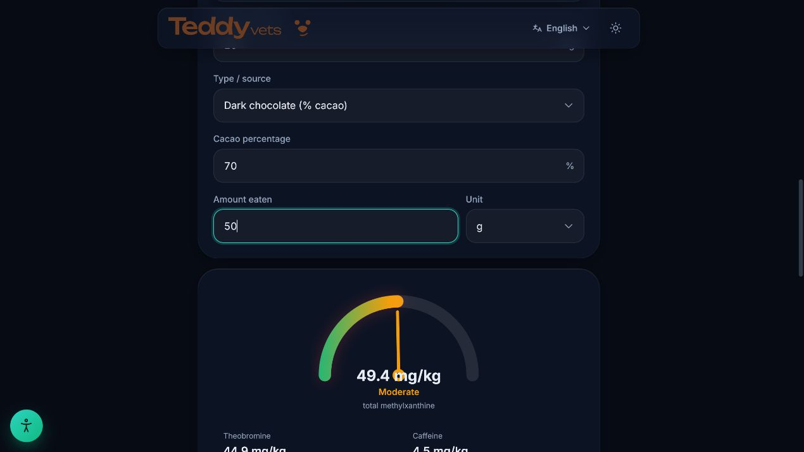

# וט־חולים · Vet-Holim

Clinical veterinary calculators for medication dosing and common toxic exposures in dogs and cats.

[Open the live application](https://vet-holim.work) · Hebrew-first, mobile-first, and available in 14 languages.

> [!WARNING]
> Vet-Holim is a clinical decision-support and triage aid. It does not replace veterinary judgment, a current formulary, or consultation with an animal poison-control service. Verify every calculation before treatment.

## Interface

### English toxic-plant library


### Chocolate toxicity calculator



The screenshot uses an illustrative exposure of a 10 kg dog ingesting 50 g of 70% dark chocolate. It demonstrates the calculation interface and is not a diagnosis or treatment recommendation.

## What it includes

- A medication dosage calculator with weight and concentration conversion, dose-range guidance, route selection, rounding, warnings, and a transparent calculation breakdown.
- A breed- and genotype-aware MDR1 (P-glycoprotein) check inside the dosage calculator, built on the published pharmacogenetic literature, plus a notice when two P-glycoprotein substrate drugs are on one patient's list.
- An emergency and critical-care tab with four field emergencies — heat-related illness, snake envenomation, pine processionary caterpillar, and organophosphate/carbamate poisoning — each summarised from studies in more than one country, with the study named beside every statement.
- Four bedside calculators in the same tab: canine shock index, the Feline Grimace Scale, transfusion volume, and an infusion-rate converter.
- Code Blue, a CPR aid for trained veterinary teams: a 2-minute cycle clock with a pause timer, a compression metronome, weight-based doses and shock energies cited from the 2024 RECOVER Guidelines, a clinic-entered crash cart for draw-up volumes, and a time-stamped event log.
- Fourteen toxin calculators: chocolate, caffeine, grapes/raisins, xylitol, allium, macadamia, lilies, THC, acetaminophen, ibuprofen, ethylene glycol, anticoagulant rodenticide, bromethalin, and cholecalciferol.
- A searchable toxic-plant library with credited plant photography.
- A reusable patient session shared across calculators.
- Cited toxin thresholds, clinical signs, suggested actions, treatment guidance, and emergency contacts.
- Fourteen localized interfaces, including full RTL layouts for Hebrew and Arabic. Clinical reference text currently falls back to English outside Hebrew.
- Accessibility controls, reduced-motion support, responsive layouts, dark/light themes, and installable PWA assets.
- Pre-rendered, language-specific pages with canonical URLs, `hreflang`, sitemap, and social metadata.

## Supported languages

Hebrew, English, Arabic, Spanish, French, German, Russian, Portuguese, Italian, Chinese, Hindi, Japanese, Turkish, and Polish.

## Technology

React 19, TypeScript, Vite, Vite React SSG, Tailwind CSS, Three.js, Framer Motion, Vitest, Testing Library, and Vercel Analytics.

## Local development

Prerequisites: a current Node.js LTS release and npm.

```bash
git clone https://github.com/Freespirits/Vet-calculator.git
cd Vet-calculator
npm ci
npm run dev
```

The development server prints its local URL after startup.

## Quality checks

```bash
npm run lint
npm run test:run
npm run build
npm run test:browser
```

The production build performs TypeScript project compilation and static-site generation. Generated output is written to `dist/` and is intentionally not committed.

`npm run test:browser` builds the site and opens it in a real Chromium with [Playwright](https://playwright.dev) (`e2e/`, configured in `playwright.config.ts`). It is separate from the unit tests because it checks what jsdom cannot: that the prerendered page survives hydration for every kind of visitor (deep links, saved theme or language, reduced motion), that `<html lang dir data-theme>` end up matching what is on screen, that deep links open and scroll to their tool, and that the dosage volume never shows a negative number while counting up. The first time, download the browser with:

```bash
npx playwright install chromium
```

Set `E2E_BASE_URL` to run the same checks against another copy of the site, such as a deploy preview: `E2E_BASE_URL=https://example.vercel.app npx playwright test`.

All three are expected to pass with no errors or warnings. Two conventions keep them that way:

- **Component files export components only.** Data and helpers that sit beside a component live in a sibling plain `.ts` file (`toxins/<id>/meta.ts`, `components/seoMeta.ts`, `lib/massUnits.ts`), which is what the `react-refresh/only-export-components` lint rule checks.
- **The first browser render must equal the prerendered HTML.** Anything only the browser knows — the URL hash, a saved theme or language, the reduced-motion setting — is read through `useSyncExternalStore` (see `hooks/useHashRoute.ts`, `useTheme.ts`, `useReducedMotion.ts`, `useHydrated.ts`), never in a `useState` initialiser. `src/hydration.test.tsx` prerenders the page, applies a visitor's state and hydrates it; a mismatch fails the test instead of surfacing as React error #418 on the live site.

## Project map

```text
src/
├── a11y/          accessibility provider, widget, statement, and tests
├── components/    shared UI, SEO, result, and treatment components
├── cpr/           Code Blue logic: cited CPR figures, dose sheet, code clock, record
├── critical/      bedside calculators: shock index, grimace scale, transfusion, infusion
├── emergencies/   field-emergency evidence: heat-illness grading and cited statements
├── data/          drug, toxin-treatment, plant, and emergency-contact data
├── features/      dosage, patient-session, plant, and toxin experiences
├── i18n/          typed translations and language metadata
├── lib/           calculation engine and safety rules
├── toxins/        toxin-specific calculators and pure calculation modules
├── webgl/         progressively enhanced hero background
└── App.tsx        application shell and section routing
```

Supporting documentation lives in [`docs/`](docs/), including the [plant photo credits](docs/PLANT_PHOTO_CREDITS.md) and [roadmap](docs/ROADMAP.md).

## Calculation model

The core dosage relationship is:

```text
total dose = patient weight × prescribed dose per unit weight
volume to draw = total dose ÷ medication concentration
```

Calculations and safety rules are kept in pure TypeScript modules and covered by unit tests. Toxicology calculators cite their clinical sources in the result view; idiosyncratic exposures do not present a misleading “safe” result.

## Data and privacy

Patient details are held in the browser for the active session. The repository excludes local source PDFs, extracted formulary material, build artifacts, dependency directories, and Vercel environment state.

## Contributing

Keep clinical logic separate from presentation, add focused tests for calculation or threshold changes, and run all quality checks before opening a pull request. Clinical-data changes should include a traceable veterinary source.

## License

All rights reserved.

## Clinical scope and workflow

The interface is designed as a professional point-of-care calculation aid for veterinarians and veterinary support teams:

- Drug search accepts generic and recognized brand names from the included database. Selecting a drug can populate species-specific dose ranges, routes, and reference notes; users can still enter an independent dose and concentration.
- Dose inputs support `mg/kg`, `mcg/kg`, `IU/kg`, and `mL/kg`; concentration inputs support matching mass or activity units per mL. Results show the unrounded and rounded draw volume, total dose, route/frequency context, warnings, and the calculation steps.
- The patient workspace stores name/identifier, species, weight, and notes for reuse across tools during the browser session.
- Toxicology results combine exposure-per-weight calculations with a risk meter, expected signs, immediate action, decontamination timing, monitoring, emergency contacts, and a source-bearing “Treat now” panel. Product identity and concentration remain clinically important; the calculator does not establish a diagnosis.
- The plant library covers 35 common toxic plants with searchable names, dog/cat relevance, affected systems, signs, severity context, and image credits.
- Results can be copied or shared where the browser supports it, and toxin routes support deep links for returning to a selected calculator.
- The app is installable and caches its clinical core for offline use after a successful first load. Offline information can become stale and must still be checked against current references.

## Code Blue (CPR aid)

Code Blue is opened from the red button above the calculator tabs, or directly at `#/cpr`. It is a timekeeping, calculation, and record-keeping aid; it never chooses or prompts a treatment.

- **Acknowledgment.** On first use on a device the screen shows only a professional-use acknowledgment. Doses and the clock appear after it is accepted; the acceptance is remembered on that device.
- **Code clock.** Starting the clock begins cycle 1. Each cycle counts down two minutes of uninterrupted compressions; "Pause & check" starts a pause timer that turns red after ten seconds; "Resume compressions" begins the next cycle. Total time keeps running throughout. A separate line shows the time since the last logged epinephrine or vasopressin against the 3–5 minute interval.
- **Metronome.** A visual and audible beat, adjustable only within 100–120 per minute.
- **Dose sheet.** Each intervention shows the dose for the entered weight, with the guideline recommendation number beside it. A drug the guideline suggests not giving to the species (lidocaine in cats) shows that warning instead of a dose.
- **Crash cart.** Draw-up volumes are calculated only from vial strengths the clinic types in (saved on the device). Nothing is pre-filled, because strengths differ between countries and manufacturers. The only built-in strengths are the two the guideline states itself (10% calcium gluconate and 10% calcium chloride).
- **Event log.** Drugs, shocks, airway, and access are time-stamped as the team logs them and can be copied as a plain-text record. The log records that something was done, not the dose that was given, and the record says it is not a medical record.

Every figure comes from one file, [`src/cpr/recoverGuideline.ts`](src/cpr/recoverGuideline.ts), read from the open-access paper: Burkitt-Creedon JM, Boller M, Fletcher DJ, et al. *2024 RECOVER Guidelines: Updated treatment recommendations for CPR in dogs and cats.* J Vet Emerg Crit Care 2024;34(S1):104–123. [doi:10.1111/vec.13391](https://doi.org/10.1111/vec.13391).

### Use of RECOVER material — owner decision required

Code Blue is an independent tool. It cites published recommendations from [The RECOVER Initiative](https://recoverinitiative.org); it is not affiliated with, endorsed, or certified by that organisation, uses no RECOVER logo, and does not reproduce the RECOVER CPR algorithm or drug dosing chart (the interface links to the official versions instead).

The organisation's [Brand & Intellectual Property Guidelines](https://recoverinitiative.org/brand-intellectual-property-guidelines/) state that its algorithms and dosing charts are copyrighted, may not be modified or incorporated into products, and that "product integration" counts as commercial use requiring written permission. They also permit quoting and summarising the guidelines with attribution. Whether an independent, cited calculator like this one needs permission is a judgment for the site owner and, ideally, a lawyer. Before Code Blue is published, the owner should consider asking The RECOVER Initiative for written confirmation through the request process described on that page.

## Emergency and critical-care tab

Opened from the fifth tab, or at `#/er/<topic>`. Each card has an interactive helper, cited statements, the full reference list, and a standing notice that it is not a treatment protocol.

- **Heat-related illness** (`#/er/heat`). Ticking the signs present gives a grade — mild, moderate, or severe — under the criteria of the revised VetCompass clinical grading tool (2026). An optional presenting temperature marks the higher-risk sub-group at 41.0 °C and above. The card then shows what was observed in that paper's validation cohort for the matching group (cases and deaths), stated as cohort proportions and not as a prediction. Cooling evidence and risk factors for death from UK and Israeli studies follow.
- **Snake envenomation** (`#/er/snake`). Findings, monitoring, and treatment evidence for Vipera palaestinae (Israel), the European adder (Sweden, Norway), pit vipers (United States), and elapids (Australia). A checklist counts the factors that were associated with death in the Israeli cohort; it is a count, not a score, because that study published no weighting.
- **Pine processionary caterpillar** (`#/er/caterpillar`). Entering the hours since contact shows the time-to-first-oral-flushing group and the tongue-necrosis frequencies the French cohort reported for it, with Portuguese and Israeli series alongside.
- **Organophosphate / carbamate poisoning** (`#/er/anticholinesterase`). Signs and course from Israeli, US, and South African studies, and a helper that places the time since the cholinergic crisis against the 7–96 hour window in which intermediate syndrome typically appears.

The same tab holds four bedside calculators:

- **Shock index (dogs)** (`#/er/shock-index`). Heart rate divided by systolic pressure, reported as below, at, or above the published cut-off of 1.0 (Porter et al., *J Vet Emerg Crit Care* 2013, [doi:10.1111/vec.12076](https://doi.org/10.1111/vec.12076)).
- **Feline Grimace Scale** (`#/er/feline-grimace`). Five facial units scored 0, 1, 2, or "not possible to score"; the score is the sum divided by the maximum possible, and no score is given when more than two units cannot be scored. A score above 0.39 was the study's threshold for rescue analgesia (Evangelista et al., *Sci Rep* 2019, [doi:10.1038/s41598-019-55693-8](https://doi.org/10.1038/s41598-019-55693-8), CC BY 4.0).
- **Transfusion volume** (`#/er/transfusion`). Dogs, packed red cells: 1.5 mL × desired PCV rise × kg, plus the donor-PCV formula when the donor PCV is entered (Short et al. 2012, [doi:10.1111/j.1476-4431.2012.00773.x](https://doi.org/10.1111/j.1476-4431.2012.00773.x)). Cats, whole blood: 2 mL × desired PCV rise × kg, shown with the authors' caveat that no formula was highly accurate (Reed et al. 2014, [doi:10.1177/1098612X13517254](https://doi.org/10.1177/1098612X13517254)).
- **Infusion rate** (`#/er/infusion`). Converts a dose rate and a prepared concentration into mL per hour. It contains no drug doses.

Not built, and why: the animal trauma triage score and the modified Glasgow Coma Scale need scoring descriptors that are only in papers that could not be read in full; a fluid-rate planner needs the 2024 AAHA Fluid Therapy Guidelines text, and that site blocks automated reading. They are waiting on the source text rather than being written from memory.

No antidote or antivenom dose is given in this tab. All statements and references live in [`src/emergencies/`](src/emergencies/); a test fails if any statement lacks a listed source or any topic cites a single country.

The heat-illness grading is an independent implementation of criteria published under a non-commercial, no-derivatives licence (Beard et al., *Sci Rep* 2026;16:4661, [doi:10.1038/s41598-025-34768-9](https://doi.org/10.1038/s41598-025-34768-9)). The card names the paper and says it is not the original chart. As with the RECOVER material, the owner should decide whether to ask the authors for permission before publishing.

## MDR1 (P-glycoprotein) check

When the drug selected in the dosage calculator has species-specific published MDR1 evidence, a card appears under the dose reference. It asks for two optional facts — breed (dogs) and MDR1 genotype — and shows what was observed, the kind of evidence, what the published review recommends, and the sources.

- **Which drugs.** Only drugs with dog- or cat-specific evidence: ivermectin, loperamide, apomorphine, acepromazine, butorphanol, cyclosporine, maropitant, digoxin, mexiletine, and fluralaner in dogs; ivermectin in cats. A drug known to be a P-glycoprotein substrate only in people or mice is not listed.
- **How loudly it flags.** A tested dog with the mutation gets a warning or a danger flag depending on the drug; an untested dog of a listed breed gets a warning with that breed's published mutation frequency; an untested dog with no breed given gets an informational note; a dog tested normal is cleared.
- **Dose changes.** A starting reduction (25% with one copy, 50% with two) is shown only for drugs the review names for dose reduction and only for a tested dog. For loperamide and apomorphine the card says to use an alternative, because no safe reduced dose is established. Nothing is inferred from breed alone, and the calculator's dose field is never changed automatically.
- **Breed figures.** Frequencies are printed exactly as in the review's table; Israeli mutant-allele frequencies are shown separately where published.
- **Elsewhere.** A dog's medication list shows a notice when it holds two or more P-glycoprotein substrates, and the apomorphine row in the toxin "Treat now" panel carries the MDR1 caution.

Sources (all in [`src/data/mdr1.ts`](src/data/mdr1.ts)): Mealey KL, Owens JG, Freeman E, *J Vet Pharmacol Ther* 2023;46(1):1–16, [doi:10.1111/jvp.13102](https://doi.org/10.1111/jvp.13102) (open access; read in full); Mealey KL et al., *Pharmacogenetics* 2001, [doi:10.1097/00008571-200111000-00012](https://doi.org/10.1097/00008571-200111000-00012); Deshpande D et al., *J Vet Intern Med* 2016, [doi:10.1111/jvim.13827](https://doi.org/10.1111/jvim.13827); Mealey KL et al., *Drug Metab Dispos* 2008, [doi:10.1124/dmd.107.018978](https://doi.org/10.1124/dmd.107.018978); Campbell O et al., *J Small Anim Pract* 2017, [doi:10.1111/jsap.12618](https://doi.org/10.1111/jsap.12618); Mealey KL, *Vet Parasitol* 2008, [doi:10.1016/j.vetpar.2008.09.009](https://doi.org/10.1016/j.vetpar.2008.09.009); Mealey KL, Burke NS, *J Vet Pharmacol Ther* 2015, [doi:10.1111/jvp.12212](https://doi.org/10.1111/jvp.12212); Dekel Y et al., *BMC Vet Res* 2017, [doi:10.1186/s12917-017-1251-9](https://doi.org/10.1186/s12917-017-1251-9); and two case reports in *J Vet Intern Med* (Sartor 2004; Henik 2006). Three further papers are cited as reported in the 2023 review and are marked that way in the data file.

## Public clinical references

The application displays source notes with its clinical results. The following public pages and indexed publications were verified while preparing this documentation; books and subscription sources named in the interface are not reproduced in this repository.

- [Chocolate toxicosis in animals — Merck Veterinary Manual](https://www.merckvetmanual.com/toxicology/food-hazards/chocolate-toxicosis-in-animals)
- [Food hazards, including grapes/raisins, xylitol, and macadamia nuts — Merck Veterinary Manual](https://www.merckvetmanual.com/special-pet-topics/poisoning/food-hazards)
- [Garlic and onion toxicosis — Merck Veterinary Manual](https://www.merckvetmanual.com/toxicology/food-hazards/garlic-and-onion-allium-spp-toxicosis-in-animals)
- [Houseplants and ornamentals toxic to animals — Merck Veterinary Manual](https://www.merckvetmanual.com/toxicology/poisonous-plants/houseplants-and-ornamentals-toxic-to-animals)
- [Toxicoses from human analgesics — Merck Veterinary Manual](https://www.merckvetmanual.com/toxicology/toxicoses-from-human-analgesics/toxicoses-from-human-analgesics-in-animals)
- [Ethylene glycol toxicosis — Merck Veterinary Manual](https://www.merckvetmanual.com/toxicology/ethylene-glycol-toxicosis/ethylene-glycol-toxicosis-in-animals)
- [Overview of rodenticide poisoning — Merck Veterinary Manual](https://www.merckvetmanual.com/toxicology/rodenticide-poisoning/overview-of-rodenticide-poisoning-in-animals)
- [Bromethalin poisoning — Merck Veterinary Manual](https://www.merckvetmanual.com/toxicology/rodenticide-poisoning/bromethalin-poisoning-in-animals)
- [THC toxicosis in dogs and cats — Merck Veterinary Manual](https://www.merckvetmanual.com/toxicology/toxicoses-from-human-recreational-drugs/toxicosis-in-dogs-and-cats-from-tetrahydrocannabinol-thc)
- [Murphy & Dunayer, “Xylitol Toxicosis in Dogs: An Update” — PubMed, PMID 30064708](https://pubmed.ncbi.nlm.nih.gov/30064708/)
- [Wegenast et al., tartaric acid as the proposed toxic principle in grapes and raisins — PubMed, PMID 35869755](https://pubmed.ncbi.nlm.nih.gov/35869755/)

These references support the subject matter and selected thresholds; their inclusion does not mean the authors, publishers, or institutions reviewed or endorsed Vet-Holim. The software has not been represented as a regulated medical device or independently clinically validated.

## Search and crawler visibility

The production build emits server-rendered HTML for all 14 canonical language URLs, reciprocal `hreflang` links, XML sitemap entries, structured application data, crawler directives, and crawlable language navigation. [`public/llms.txt`](public/llms.txt) provides a concise machine-readable project and reference guide. Search-engine and AI-system inclusion remains controlled by those services; publishing these files does not guarantee indexing. After deployment, the owner should submit or resubmit the sitemap in Google Search Console and request inspection of the canonical root and English URLs.

## License

All rights reserved.
